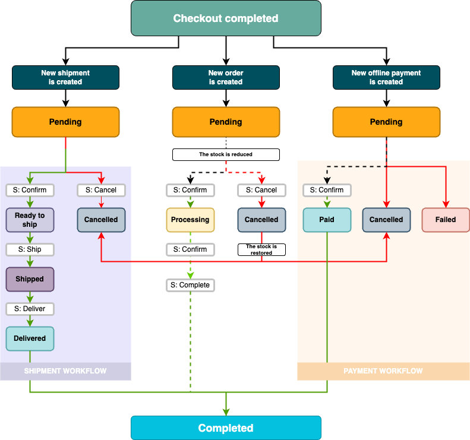

# [[= product_name_commerce_sdk =]]

The [[= product_name_commerce_sdk =]] extends [[= product_name =]] with e-commerce capabilities.
It doesn't come with [[= product_name =]] out of the box: your administrator or development team must [install it separately]([[= developer_doc =]]/commerce/install_commerce_sdk/).
It consists of several components that you can use to create a unified and streamlined e-commerce platform.
Components interact with each other, for example, to decrease stock following a sale, reduce prices when the cart reaches a certain value, or cancel shipments and payments when orders are cancelled.

The [[= product_name_commerce_sdk =]] complements functionalities provided by the [product catalog](products.md) offering, and allows you to sell products through the website.
With the [[= product_name_commerce_sdk =]], you can build your own storefront from a set of generic UI components, which you can then customize to cover all aspects of the e-commerce experience.

By default, the [[= product_name_commerce_sdk =]] is configured to follow a specific workflow and support a certain number of processing method types, for example, flat rate, free shipping methods, and offline payment methods.
Contact your administrator or development team about customization options.
For more information, see [Developer Documentation]([[= developer_doc =]]/commerce/commerce/).

The following diagram includes statuses and actions that may occur on the order's way along the fulfilment path.

From the end-user perspective, once it's properly configured to grant the right permissions to [user roles](../permission_management/permissions_and_users.md), the [[= product_name_commerce_sdk =]] gives store managers control over the whole order fulfilment process, while allowing customers to monitor the progress of their transactions.

Once the order is placed, users can interact with it by working with the following back office pages:

[[= cards([
    "commerce/order_management/order_management",
    "commerce/payment/payment_management",
    "commerce/shipping_management/shipping_management",
    "commerce/discounts/discounts"
], columns=3) =]]
