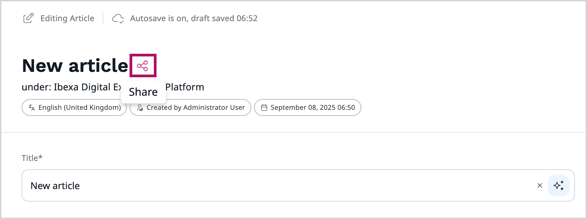
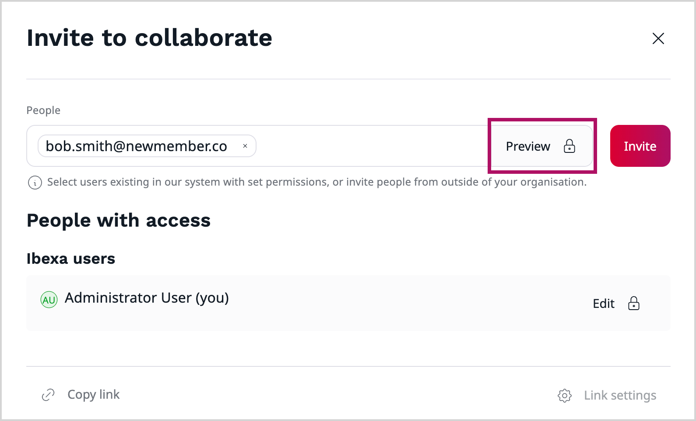
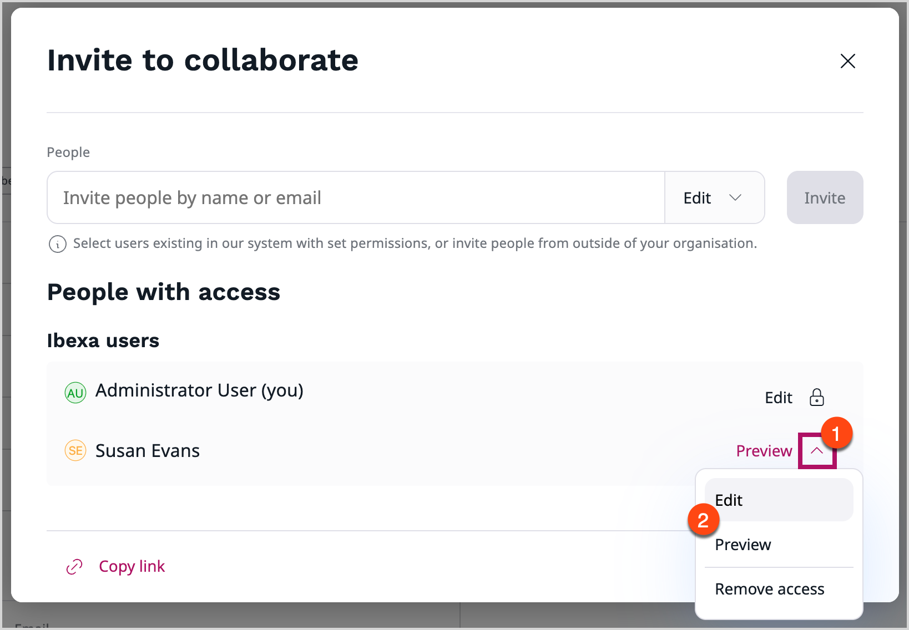
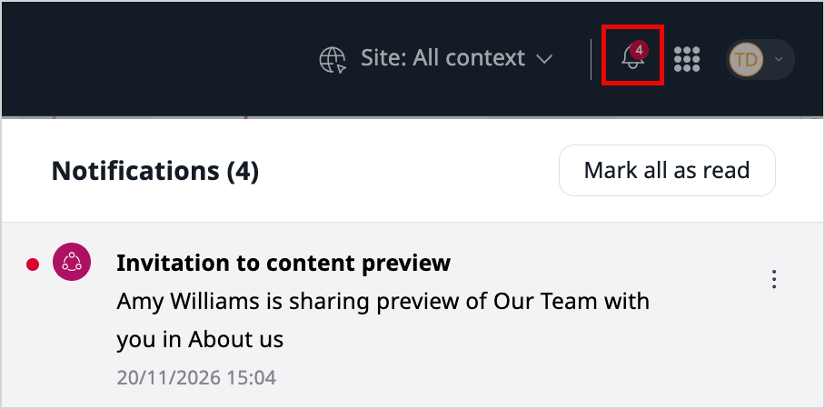
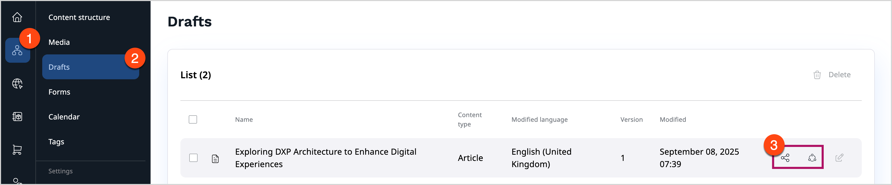
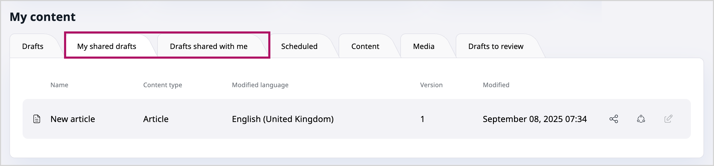

# Content sharing

Content sharing is an [LTS Update]([[= developer_doc =]]/ibexa_products/editions#lts-updates) that allows you to share content drafts with other users, so that they can preview and review them before publication.
It's not included in [[= product_name =]] by default and requires separate installation and system configuration.

By giving users access to preview the content before it's published, review and collaboration become much easier.
An additional option here is the ability to copy a link to the content item, which allows to share it through communication channels.
It improves collaboration with members of other teams, such as subject matter experts, compliance professionals, and sales representatives, to increase content quality.

## Collaboration session

You can invite other users to join a collaboration session when you create a new draft of a content item, or when you view an existing content item.

To invite collaborators, create a new collaboration session:

- click the **Share** icon in the editing screen of a content item draft
- click the **Share** button in the details screen of an existing content item - this creates a new draft and opens it in the editing screen. If the content item has more than one translation, select the language first.

Then, in a pop-up window, you can invite users to the newly created session.
You can invite two types of users:

- **Internal** - by searching their name or email address.
- **External** - by providing their email address in the field.

To confirm the provided email address, press the **Enter** key on your keyboard.

!!! tip "Access restrictions"

    When inviting internal users, you can only invite users with permissions to access the shared content.
    Users without permissions are grayed out and you can't select them and invite them to the session.
    Both internal and external users can only preview the content item.

After you invite the user by clicking the **Invite** button, they appear in the **People with access** list.
In the same pop-up window, you can remove access for specific user.
To do it, click the **Arrow symbol** and select **Remove**.

Additionally, you can share a direct link to the collaboration session without specifying a particular user.
To do it, click the **Copy link** button.
Link is copied to the clipboard and you can share it with the users through communication channels.

Use the **Link settings** button to control whether a user needs an account in the system to preview content using the direct link.

To confirm inviting users and create a session, you must **Save and close** the draft.

After you invite users to a collaboration session, they receive a notification:

- visible when clicking the **Notification** icon on the main dashboard (internal users)
- by email (external users)

Collaboration session begins when the first invited user accepts the invitation and joins the session, and ends when the owner performs one of the following action:

- save and close
- publish the content (including "Publish later" option)
- delete content draft
- discard
- move the draft in the workflow
- end collaboration session

Apart from clicking an invitation, internal users can also join a collaboration session using the **Join** button:

- available in the [**My content** block tabs](#dashboard-block-tabs) on the dashboard
- by accessing a content draft in the **Drafts** menu
- in the **Versions** tab of the content item

Invited users who join the session see the preview of the draft.
The owner of the draft is taken to the editing screen instead.

Each user can leave the collaboration session or rejoin it at any moment.

## Work with shared drafts

You can access the shared draft in **Content** -> **Drafts**.
Here you can join your collaboration session, share the draft with more users or revoke their invitations, or delete the draft.

Other users with access to the shared content item can edit the content item and create new drafts, share them with other users, or delete their draft, but they can't access or preview drafts that are associated with your collaboration session.

## Dashboard block tabs

Content sharing feature brings two tabs in **My content** dashboard block:

- **My shared drafts** - displays all drafts with active collaboration sessions that you shared with others.
From this tab, you can perform the following actions: Share, to invite more users or revoke their invitations, and Join, to edit your draft

- **Drafts shared with me** - displays all drafts with active collaborations that other users shared with you.
From this tab, you can only Join the session to preview the content item

