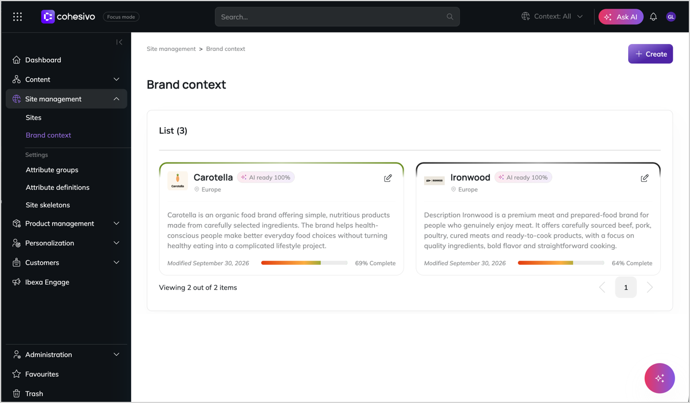

# Brand context

With brand context, you can describe a brand once and reuse that business perspective in all the websites that represent the brand.
A brand context holds the brand's name, logo, and colors, information about its market and communication channels, and [guidelines for AI-generated content](#brand-context-and-ai).

For more information about creating and managing brand contexts, see [Work with brand contexts](work_with_brand_contexts.md).

!!! tip "Permissions"

    AI actions follow the brand's AI guidelines for everybody, regardless of their permissions.
    To work with brand contexts, you may need [additional permissions](work_with_brand_contexts.md#permissions).

## Brand context and websites

You can assign [many websites](multisite.md) to one brand context, for example, the websites that a brand runs for specific countries, languages, or audiences.
Each website can belong to only one brand context.

For example, a food producer might have the following websites:

- **Carotella** - for individual customers
- **Carotella Pro** - for professional kitchens
- **Carotella Trade** - for distributors, retailers, and food processors

All three websites belong to the same brand context but have their own content, languages, and presentation.

Websites that belong to one brand context must share the same content tree root.
In the content tree, a badge with the brand context name marks where each brand's content starts.

In **Site management** → **Sites**, the list of websites shows the brand contexts that each site belongs to, and you can filter the list by brand context.

In the top bar, the **Context** drop-down list groups websites by brand context.
When you choose a website, the [content tree](../getting_started/discover_ui.md#content-tree), [previews](../content_management/preview_content_items.md), and the default language of new content items follow that website's configuration.
If the website belongs to a brand context, AI actions also follow the brand context's AI guidelines.

## Attributes and attribute groups

Every brand context has the following basic information:

- name, identifier, and description
- logo and primary color
- region

Other information is stored in attributes.
An attribute holds a single piece of information, for example, a tagline or a contact email.
Related attributes are organized into attribute groups, and each group has its own tab on the brand context screen.

By default, [[= product_name =]] comes with the following attribute groups:

- **Identity** - brand name, tagline, additional logos and colors, fonts, tone of voice, and brand values
- **Market** - target countries and audience, currency, legal entity, and compliance notes
- **Channel** - channel type, social media profiles, and contact and support information
- **AI Context** - guidelines for AI-generated content

The AI Context group is a system group that you can't delete.
You can add your own attributes to any group, including AI Context, and create your own attribute groups.

For more information, see [Work with brand context attributes](work_with_brand_context_attributes.md).

## Brand context and AI

Guidelines for AI-generated content, for example, writing style or topics to avoid, are stored in the **AI Context** attributes of a brand context.

When you choose a website in the top bar and run an AI action, for example, from the [AI Assistant](../content_management/create_edit_content_items.md#ai-assistant), [[= product_name =]] adds the AI Context attributes of the website's brand context to the prompt.
The attributes are used in the language that the AI action works in, so translate them into all the languages of the brand's websites.

If you don't choose any website, or the chosen website doesn't belong to any brand context, AI actions don't use brand guidelines.

You can check which brand context applies:

- When you create or edit content, a message in the form shows the chosen brand context, or suggests that you pick one
- In the details of an AI action, the **Final prompt** field shows the prompt that includes the AI Context attributes of the chosen brand context. For more information, see [View AI action details](../ai_actions/work_with_ai_actions.md#view-ai-action-details)
- On the brand context screen, the **AI ready** percentage shows how many of the AI Context attributes are filled in
