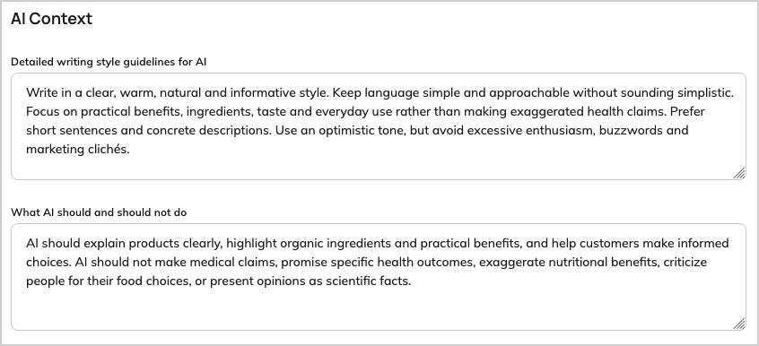
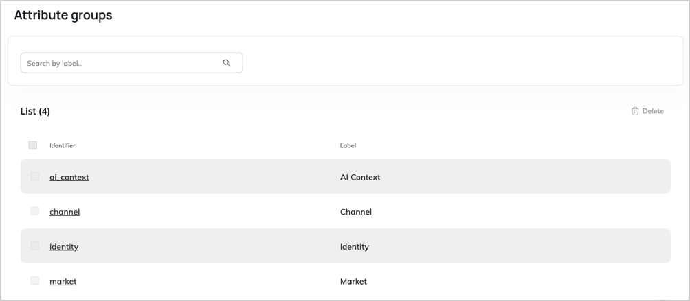
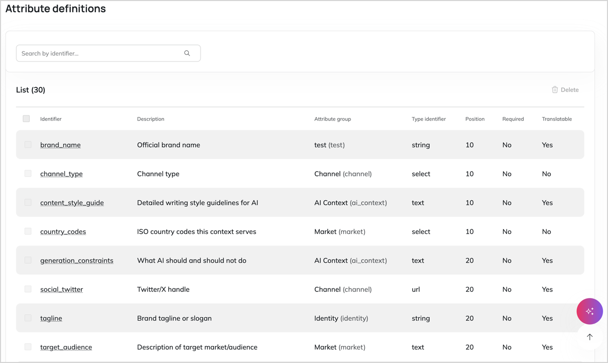
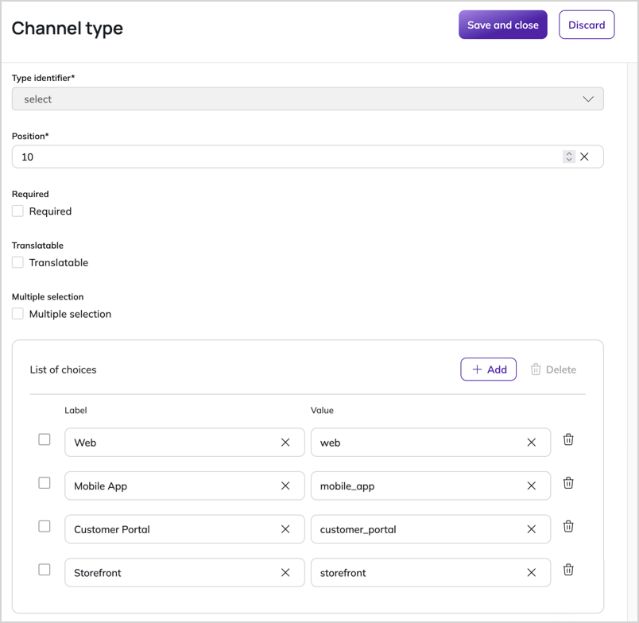

# Work with brand context attributes

With attributes, you can store any information about a brand in its [brand context](brand_context.md), for example, a list of product lines or a link to the brand book.
You can add attributes to the [default attribute groups](brand_context.md#attributes-and-attribute-groups) or create your own groups.
Attributes that you add to the **AI Context** group guide AI actions in the same way as the default ones.

To manage attributes and attribute groups, you may need [additional permissions](work_with_brand_contexts.md#permissions).

## Manage attribute groups

Each attribute group appears as a separate tab on the brand context screen, and as a section in the brand context editing form.

### Create an attribute group

1. In the left panel, go to **Site management** -> **Attribute groups** and click **Create**.
1. In the attribute group editing screen, provide the following information:
    - **Language** - a base language for the attribute group
    - **Label** - a human-readable name for the attribute group
    - **Identifier** - a unique identifier used by the system

1. Click **Save and close** to create the attribute group.

The attribute group is now available when you edit or create attributes, and appears on brand context editing screens.

### Edit existing attribute group

1. In the attribute groups list, click the name of the attribute group that you want to edit.
1. On the attribute group details screen, click **Edit**.
1. Modify the fields as needed and click **Save and close** to save your changes.

#### Translate attribute group

You can translate the name of an attribute group to additional languages.

1. On the attribute group details screen, go to the **Translations** tab and click **Add**.
1. Choose the new language and the base translation to copy values from, and click **Create**.
1. On the editing screen, replace the label in the source language with a translation.
1. Click **Save and close** to save the translation.

### Delete attribute group

You can delete an attribute group only when it doesn't contain any attributes.
You can't delete the **AI Context** group.

1. In the attribute groups list, click the name of the attribute group that you want to delete.
1. On the attribute group details screen, click **Delete**.
1. In the confirmation modal, click **Delete**.

## Manage attributes

Each attribute definition describes one piece of information, its type, and the group where it appears.

### Create attribute

1. In the left panel, go to **Site management** -> **Attribute definitions** and click **Create**.
1. Choose the language and the type for the attribute and click **Create**.
     Available attribute types are:
     - **Integer** - whole numbers
     - **String** - single-line text input
     - **Text** - multi-line text area
     - **Rich text** - multi-line text with formatting
     - **Selection** - a list of options to choose from
     - **URL** - a URL address
     - **Email** - an email address
     - **Color** - a color selection in hexadecimal format
     - **Content** - a content selector that opens a content browser
     - **Structure** - nested data in JSON format, for storing any hierarchical data without a database structure
1. In the brand context attribute editing screen, provide the following information:
    - **Description** - a brief description of what this attribute is for. For attributes in the **AI Context** group, describe clearly what the value means, because AI actions use the description to interpret the value
    - **Identifier** - a unique identifier used by the system
    - **Attribute group** - the group to which this attribute belongs
    - **Position** - a place in which this attribute appears within its group
    - **Required** - a check box that decides if this attribute must be populated in every brand context
    - **Translatable** - a check box that decides if the value of this attribute can be translated to different languages

1. If you chose **Selection** as the attribute type, define the available options:
    1. Select **Multiple selection** to allow users to choose multiple options from the list
    1. In the **List of choices** section, click **+ Add**
    1. Enter the option label and value

1. Click **Save and close** to create the attribute.

The newly created attribute is now available on brand context editing screens within its assigned attribute group.

### Edit existing attribute

1. In the brand context attributes list, click the name of the attribute that you want to edit.
1. On the attribute details screen, click **Edit**.
1. Modify the fields as needed and click **Save and close** to save your changes.

#### Translate attribute

You can translate brand context attribute definitions to additional languages.

1. On the attribute details screen, go to the **Translations** tab and click **+ Add**.
1. Choose the new language and the base translation to copy values from, and click Create.
1. On the editing screen, replace the source text with translations, including selection options, where necessary.
1. Click **Save and close** to save the translation.

### Delete attribute

!!! caution "Risk of data loss"

    When you delete a brand context attribute definition, any values that are entered for that attribute in brand contexts are also deleted.

1. In the brand context attributes list, click the name of the attribute that you want to delete.
1. On the details screen, click **Delete**.
1. In the confirmation modal, click **Delete**.

The attribute is deleted from the system and from all brand contexts.
