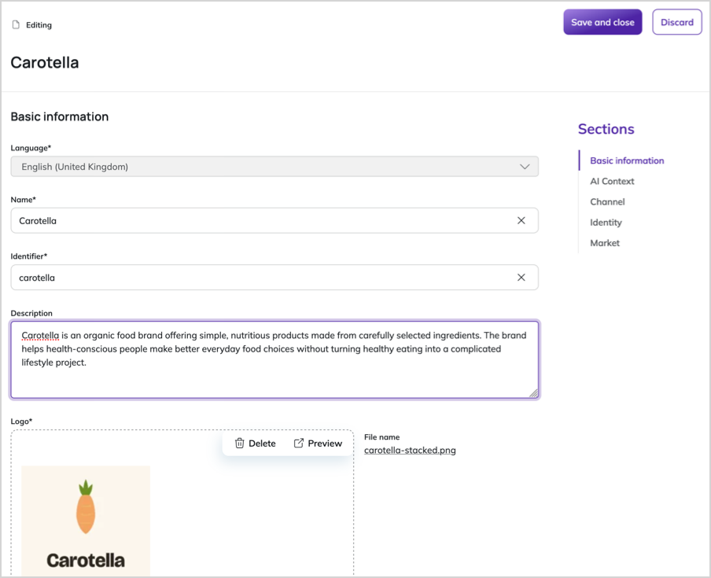
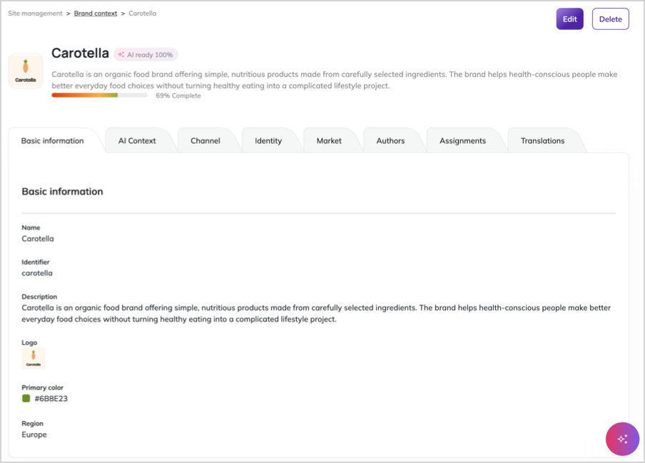
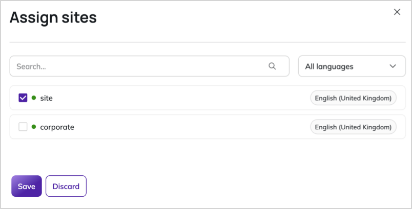

# Work with brand contexts

You can create a [brand context](brand_context.md) for each brand of your organization, fill in the brand's information and AI guidelines, and assign the brand's websites to it.

To see the list of brand contexts, in the left panel, go to **Site management** -> **Brand context**.
Each brand context in the list shows how complete its information is.

!!! tip "Permissions"

    To work with brand contexts, you need specific [permissions](../permission_management/permission_system.md).
    If **Brand context** isn't available in the left panel, or some of its actions are missing, contact your administrator.

    If you're the administrator, you can grant the `Brand Context` and `Brand Context Attributes Configuration` policies to roles, and limit all brand context policies, except `Brand Context/Create`, to selected brand contexts.

## Create new brand context

1. In the left panel, go to **Site management** -> **Brand context** and click **Create**.
1. Choose the language in which you want to create the brand context and click **Create**.
1. In the **Basic information** section, provide the following information:

    - **Name** - the name of the brand context
    - **Identifier** - a unique identifier used by the system
    - **Description** - a short description of the brand context
    - **Logo** - an image that you upload or choose from the library
    - **Primary color** - the brand's main color, picked from the palette or entered as a hexadecimal value
    - **Region** - the market or region in which the brand operates

1. In the sections that follow, fill in the [attributes](brand_context.md#attributes-and-attribute-groups) that apply to the brand.
Fill in the **AI Context** attributes if you want AI actions to follow the brand's guidelines.

    !!! tip "Checking how brand context affects AI"

        After you have created a brand context, you can check which brand guidelines AI actions use:

        1. In the top bar, in the **Context** drop-down list, choose a website that belongs to the brand context.
        1. In the **Final prompt** field of the [AI action details](../ai_actions/work_with_ai_actions.md#view-ai-action-details), see the full prompt that an AI action sends.

1. Click **Save and close**.

## Edit existing brand context

1. In the brand context list, click **Edit** next to a name of the brand context.
1. Choose the language that you want to edit and click **Edit**.
1. Change the basic information or the attributes.
1. Click **Save and close**.

## View brand context details

To review the details of a brand context, in the brand context list, click its name.

The brand context details screen shows:

- a progress bar with an approximate indication of how complete the brand context is
- the **AI ready** percentage, which tells you how many of the AI Context attributes are populated

You can use a brand context even if some of its fields are empty.

The information is divided into the following tabs:

- **Basic information** - name, identifier, description, logo, primary color, and region
- one tab for each attribute group, for example, **Identity** or **AI Context**
- **Assignments** - websites assigned to the brand context
- **Translations** - languages in which the brand context is available
- **Authors** - who created and last modified the brand context, and when

### Assign websites to brand context

Each website can belong to only one brand context, and all websites in a brand context must share the same content tree root.

1\. On the brand context details screen, go to the **Assignments** tab and click **Assign sites**.

2\. In the **Assign sites** window, choose the websites that you want to assign.
You can search for websites by name, and filter them by language.
Websites that already belong to another brand context are unavailable.
To assign such a website, first unassign it from its current brand context.

3\. Click **Save**.

To remove a website from a brand context, on the **Assignments** tab, click **Unassign** next to the website, and confirm.

### Translate brand context

You can translate a brand context into the languages of the websites that belong to it.
AI actions use the AI Context attributes in the language that they work in, so make sure that these attributes are translated.

1. On the brand context screen, go to the **Translations** tab and click **Add**.
1. Choose the new language and the base translation to copy values from, and click **Create**.
1. On the editing screen, translate the basic information and the attributes.
1. Click **Save and close**.

### Delete brand context

!!! caution "Risk of data loss"

    When you delete a brand context, all its information, including AI guidelines, is deleted.
    The websites assigned to it remain in the system, but no longer belong to any brand context.

1. On the brand context details screen, click **Delete**.
1. In the confirmation modal, review the list of websites assigned to the brand context, and click **Delete**.
